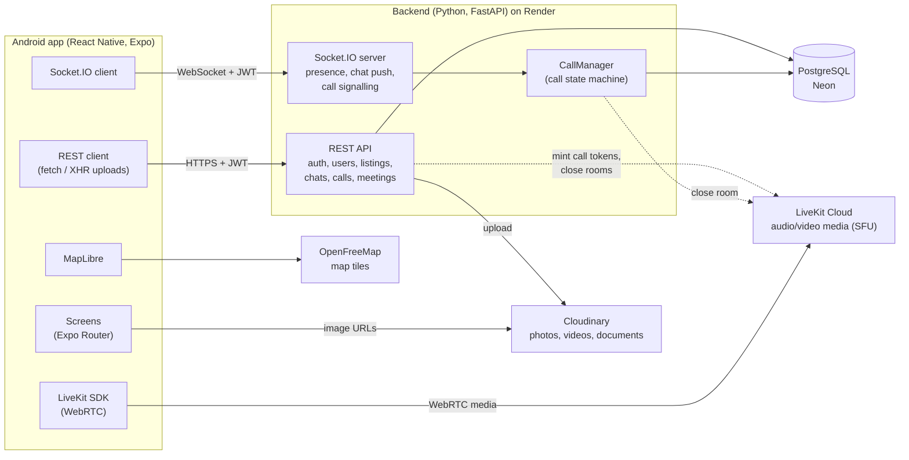
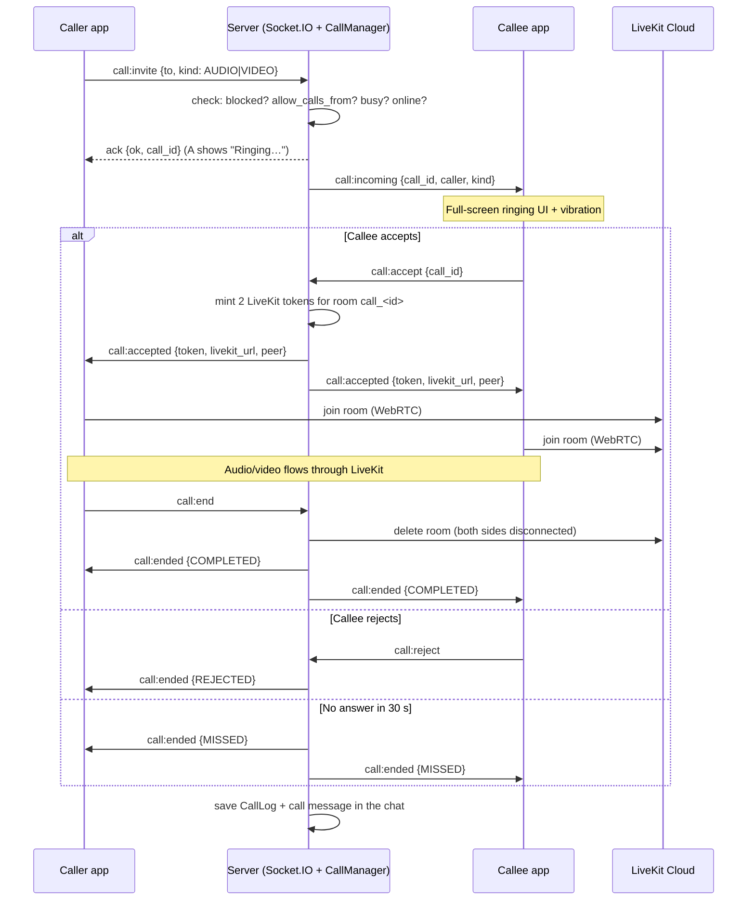
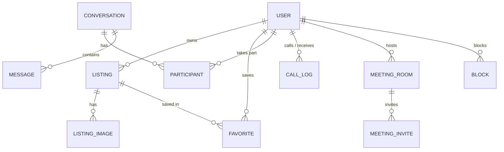

# LandConnect: technical architecture

This page explains how the prototype is built: the parts, how they talk to each other, and how the key feature (in-app audio and video calling) works. The reasons behind each choice are in [DECISIONS.md](DECISIONS.md), and the step-by-step history, including the problems found and fixed, is in [DEVLOG.md](DEVLOG.md).

## 1. System overview



| Part | Technology | What it does |
|---|---|---|
| Mobile app | React Native 0.88 (Expo SDK 58, dev build), TypeScript, Expo Router | All screens; secure token storage; camera, gallery, GPS, maps, calls |
| REST API | FastAPI, SQLAlchemy 2, Alembic, Pydantic | Accounts and roles, listings, favourites, chats, call history, meetings, privacy settings |
| Realtime | python-socketio (ASGI), on the same port as the REST API | Online presence, new-message and typing push, call invite/accept/reject/end |
| Database | PostgreSQL on Neon (free tier) | Users, listings, images, conversations, messages, call logs, meetings, blocks |
| Call media | LiveKit Cloud (free tier) | Carries the actual audio, video and screen share between participants |
| File storage | Cloudinary (free tier) | Listing photos, chat photos/videos/documents, video thumbnails |
| Maps | MapLibre + OpenFreeMap tiles | Listing map, mini maps, location picker; no API key or billing |
| Hosting | Render (free web service), EAS Build (APK) | `render.yaml` blueprint; one worker process |

Every service is on a free plan that needs no credit card (see D5).

## 2. Code layout

```
app/                      Expo React Native app
  src/app/                screens (file-based routes)
    (tabs)/               Chats, Community, Calls, Profile
    listing/, chat/, meetings/, meeting/, login, register, new-call
  src/api/                REST client, token storage, shared types
  src/auth/               AuthContext (login state, refresh)
  src/realtime/           SocketContext (one socket for the whole app)
  src/calls/              CallContext (state machine), CallOverlay, InCallChat, meeting invites
  src/chat/               unread badge, attachments, formatting
  src/components/         UI kit, brand, maps, gallery, location picker
server/
  app/main.py             FastAPI + Socket.IO mounted as one ASGI app
  app/routers/            auth, users, listings, chats, calls, meetings
  app/services/           calls (CallManager), chat, images (Cloudinary), livekit
  app/realtime.py         Socket.IO handlers (auth, presence, typing, calls)
  app/models.py           SQLAlchemy models
  alembic/                database migrations
  tests/                  51 pytest tests (SQLite + live Socket.IO tests)
  scripts/                seed data, service check, laptop test peer, brand assets
docs/                     plan, decisions, dev log, this file
render.yaml               backend deploy blueprint
```

## 3. Users, roles and permissions

Registration asks for a role: **Buyer**, **Seller** or **Broker**. The role is stored on the user and checked by the server on every request, through the `require_role(...)` dependency. The app hides buttons the role can't use, but the server is what enforces it.

| Action | Buyer | Seller | Broker |
|---|:-:|:-:|:-:|
| Browse listings, map, save favourites | ✅ | ✅ | ✅ |
| Chat, audio and video calls | ✅ | ✅ | ✅ |
| Create, edit and delete own listings, upload photos | ❌ | ✅ | ✅ |
| Create meeting rooms and invite people | ❌ | ✅ | ✅ |
| Join a meeting they were invited to | ✅ | ✅ | ✅ |

**Authentication:** passwords are hashed with bcrypt. Login returns a short-lived **access token** (JWT, 60 min) and a **refresh token** (JWT, 14 days), stored in the phone's encrypted SecureStore. When an access token expires, the app refreshes it once and retries the request. The socket uses the same token, and on an "unauthorized" refusal it refreshes and reconnects.

## 4. Privacy model

The brief's core idea is that buyers and sellers can talk **without exchanging phone numbers**. The design follows from that:

- **No phone numbers or emails are shown to other users.** The API has two user shapes: `UserMe` (your own profile) and `UserPublic` (everyone else: name, role, avatar, online status). Contact details are never in `UserPublic`, so no screen can leak them by mistake.
- **Calls go through the app, not the phone network.** Users call a person, never a number. The only identifiers involved are random UUIDs.
- **Who can call you:** `allow_calls_from` is either everyone or only people you already have a chat with. The server checks it before ringing.
- **Online status** can be hidden (`show_online_status`).
- **Approximate listing location:** with *hide exact location* on, other users get coordinates rounded to about 1 km and no street address. Only the owner sees the exact point.
- **Blocking:** a blocked user can't message you, call you, invite you to meetings or find you in search.
- **Call media is scoped:** a LiveKit token is minted only after the callee accepts, it's valid only for that call's room, and the room is deleted when the call ends.

## 5. In-app calling (the key feature)

Calling is split into two layers:

1. **Signalling** (who is calling whom, ringing, accept, reject, end) runs on **our own Socket.IO server**. That keeps the business rules (roles, blocking, call permissions, call history) in our code.
2. **Media** (audio, video, screen share) runs on **LiveKit**, a WebRTC SFU. It handles NAT traversal, codecs and bad networks, which would be unrealistic to build well for a prototype.

### Call lifecycle



**Server side (`server/app/services/calls.py`).** `CallManager` keeps the live calls in memory. Each call is RINGING, then ONGOING, then finished as COMPLETED, REJECTED, MISSED (no answer, or the callee was offline) or CANCELLED (the caller hung up before an answer). It handles:
- a **30-second ring timeout**, after which the call becomes a missed call;
- **busy users**, who can't receive a second call;
- **disconnect grace (20 s):** if either side's socket drops (Wi-Fi switch, app in the background), the call isn't killed at once. If the callee reconnects while the call is still ringing, `call:incoming` is sent again, so the ring isn't lost;
- **one finish path:** every outcome closes the `CallLog` row, posts a call message in the pair's chat ("Missed video call", "Voice call · 3:12"), and pushes `call:ended` to both sides.

Because live call state is in memory, the backend runs as **one worker process**. A multi-instance version would move it to Redis (see D9).

**App side (`app/src/calls/`).** `CallContext` is a small state machine (idle, outgoing, incoming, active, ended) shared by the whole app. `CallOverlay` is mounted above every screen, so a call can arrive anywhere in the app. It contains:
- the incoming screen (accept or decline) and the outgoing "Ringing…" screen;
- the active call, inside `LiveKitRoom`: remote and local video, mute, camera on/off, flip camera, speaker/earpiece, viewing a remote screen share, and **in-call chat** over LiveKit's data channel;
- a short "Call ended" summary.

Camera and microphone permissions are requested at the moment of the call, and the screen is kept awake during it.

**Meeting rooms** reuse the same building blocks for group calls. A seller or broker creates a meeting and invites people; invitees get a push notification and a note in their chat. `POST /meetings/{id}/join` gives a LiveKit token only to the host or an invitee, and only while the meeting is open. When the host taps **End for everyone**, the server deletes the room, which disconnects everyone.

## 6. Listings, media and maps

- **Listings** have a title, description, price (₹, shown in lakh or crore), area (acres or sq ft), land type, city, address and coordinates, and status (available or sold). Search filters by text, city, price range, "mine" and "favourites", with pagination.
- **Location:** the app's `LocationPicker` uses GPS plus a draggable map with a centred pin, and fills in the address with reverse geocoding.
- **Photos** are picked from the gallery or camera and uploaded one at a time to `POST /listings/{id}/images`. The server checks the type and size and stores them on Cloudinary. Uploads use `XMLHttpRequest`, because Expo's fetch can't send React Native file parts (DEVLOG Step 13).
- **Maps:** the Community tab toggles between a feed and a MapLibre map of all listings. Each listing page shows a mini map, which shows the approximate area when the exact location is hidden.

## 7. Messaging

- One conversation per pair of users, created on first contact, optionally with a note about the listing it started from ("About: 5 acre farmland, Nashik").
- Message types: text, photo, video (with a generated thumbnail), document (PDF and Office files, keeping the file name), call log, and system notes.
- **Realtime:** a new message is saved over REST, then pushed to both users' Socket.IO rooms (`user:<id>`). The app also shows typing indicators, read ticks, unread badges, and optimistic sending (a message appears immediately, then is confirmed).

## 8. Data model



Every primary key is a random UUID, so IDs can't be guessed or counted (D6). Schema changes are versioned with Alembic.

## 9. Testing

- **51 automated backend tests** (`server/tests`, `pytest`), on an in-memory SQLite database:
  - auth and roles, listing permissions, privacy rounding, chat and attachments, meetings;
  - the full call state machine: accept, reject, timeout, busy, block, disconnect grace;
  - **live Socket.IO tests**, which start a real server and connect two socket clients that call each other.
- **Manual end-to-end testing** on a real Android phone (Xiaomi), with the laptop as the second user through `scripts/test_peer.py`. The test peer answers or rejects calls, replies to chats, joins meeting invites, and opens a browser tab as its camera. Every feature was checked this way, and the problems it found are written up in the DEVLOG.

## 10. Deployment

- **Backend:** Render free web service from `render.yaml`. The start command applies migrations (`alembic upgrade head`) and then starts one uvicorn worker. Secrets are entered in the Render dashboard, not stored in git. Note: the free tier **sleeps after about 15 minutes idle**, so the first request after a pause takes about 30–60 seconds to wake it.
- **App:** the APK is built with EAS Build. The `preview` profile makes a standalone APK, with the hosted API URL set through `EXPO_PUBLIC_API_URL`. The `development` profile makes the dev client used while building.

## 11. Known limits and what production would need

| Prototype | Production |
|---|---|
| Call state in one process's memory | Redis-backed state, several workers behind a load balancer |
| Incoming calls ring only while the app is open or in the background | FCM push notifications + Android ConnectionService / CallKit, so a closed app still rings |
| Free tiers (server sleeps, LiveKit and Cloudinary quotas) | Paid always-on hosting, autoscaling |
| No email or phone verification | OTP verification, KYC for sellers and brokers |
| Open CORS | Restricted origins, rate limiting, audit logs |
| Listing videos not supported (chat videos are) | Video uploads on listings with transcoding |
